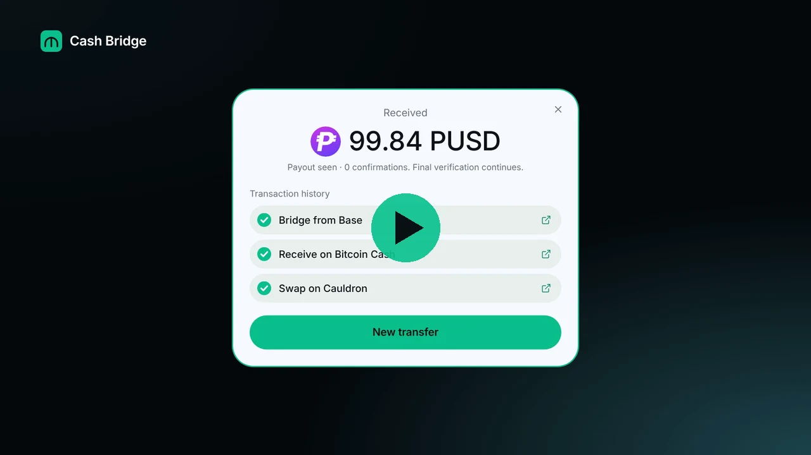
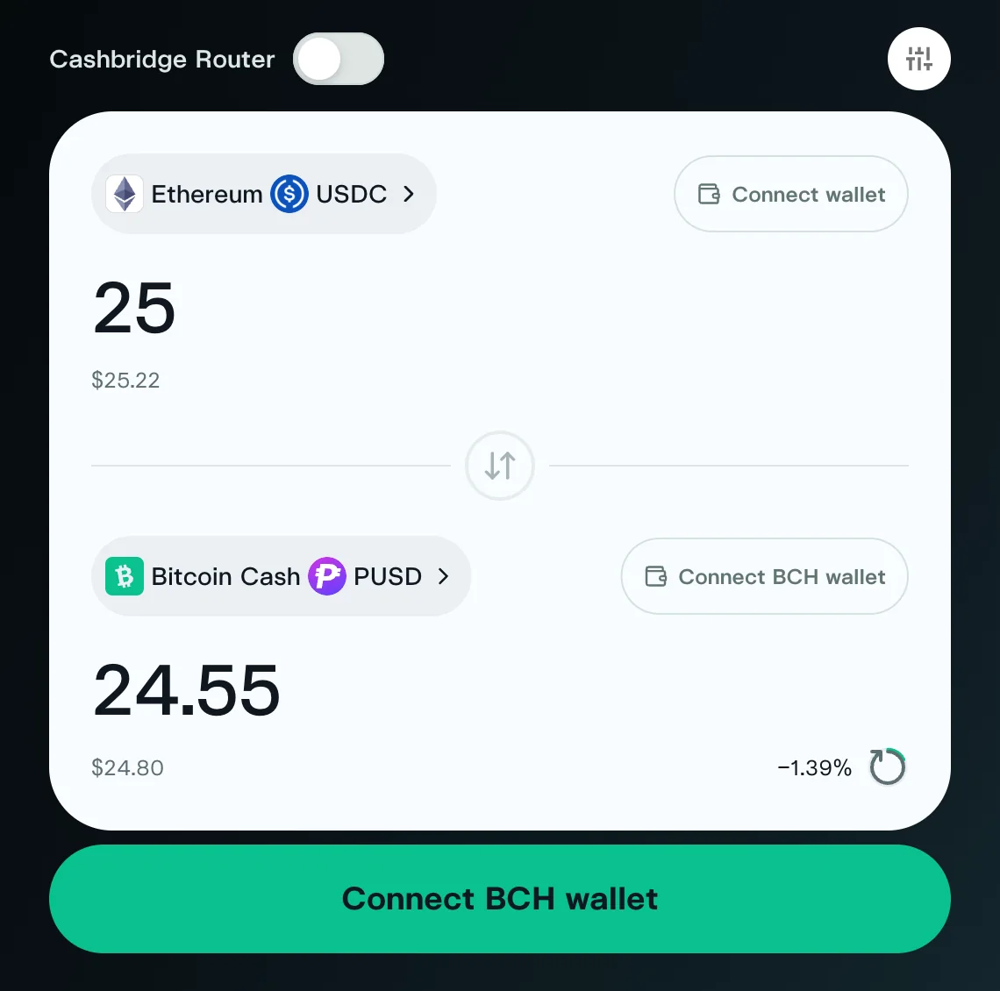
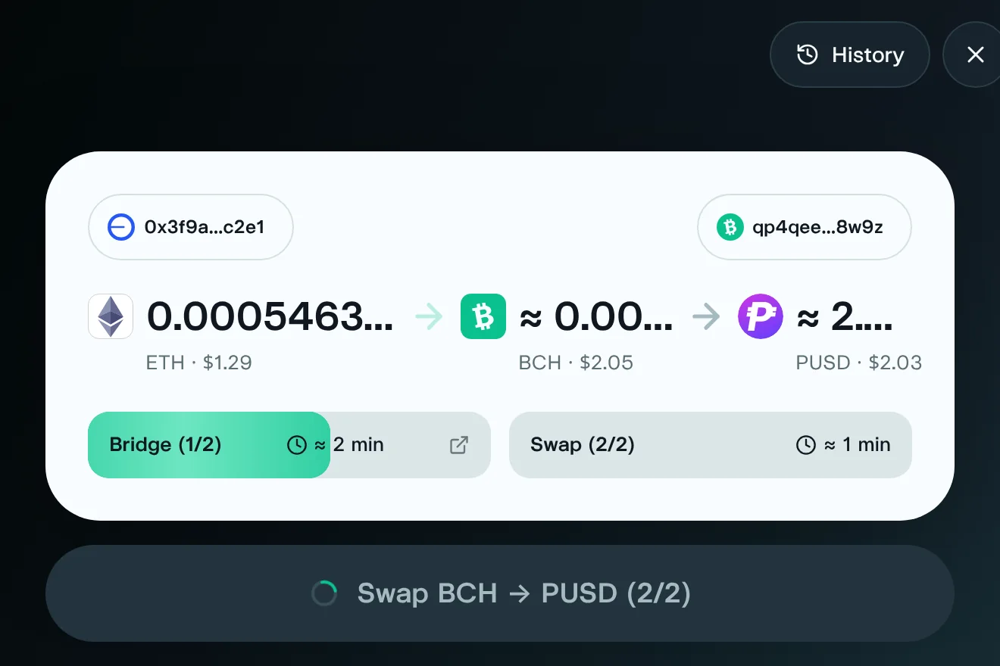
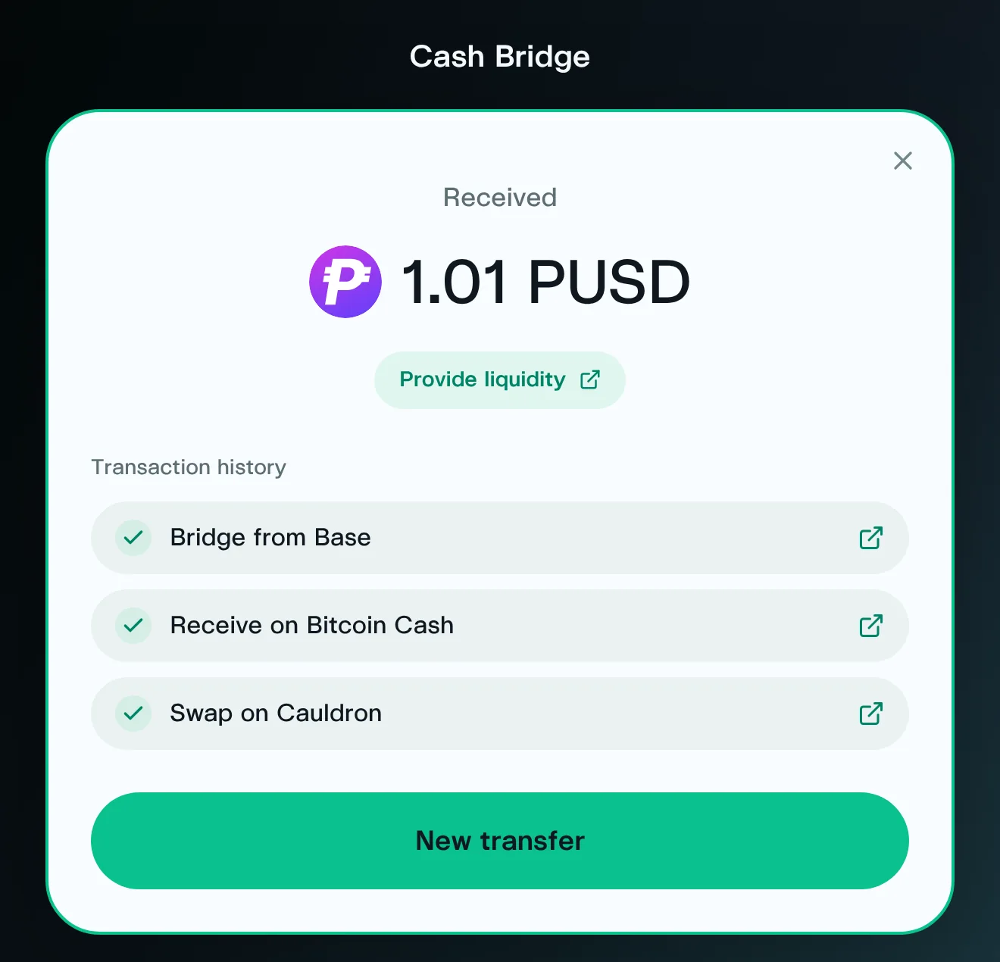
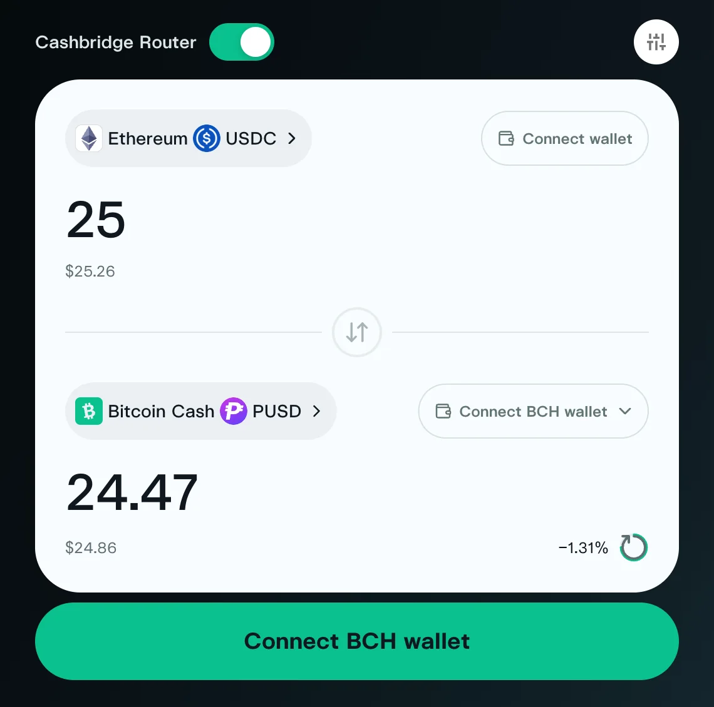
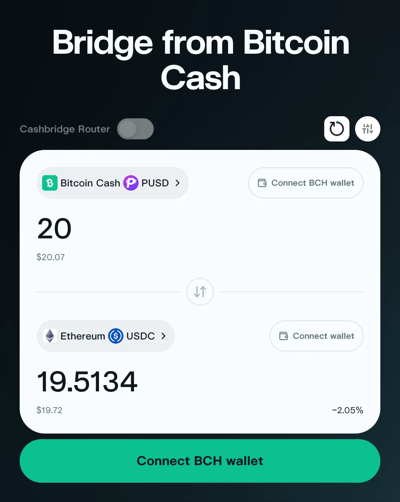
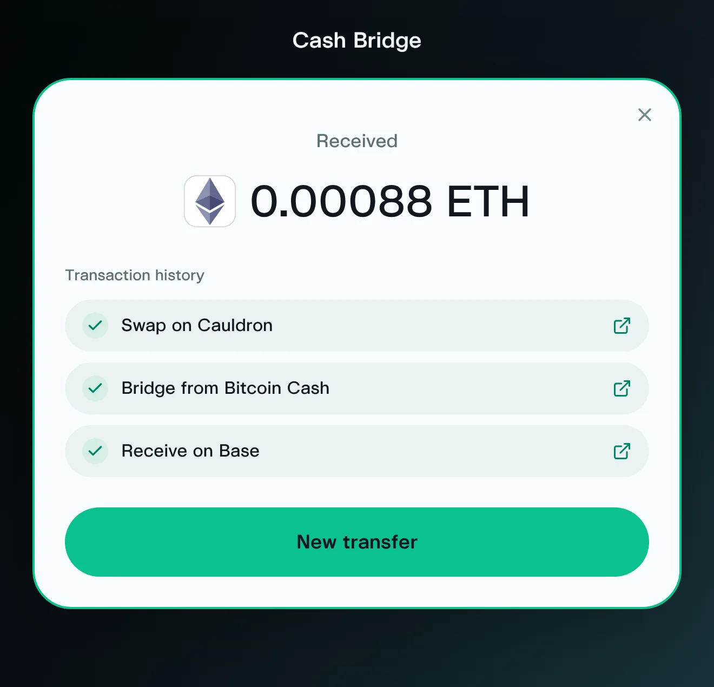
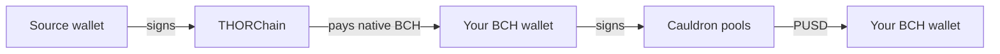
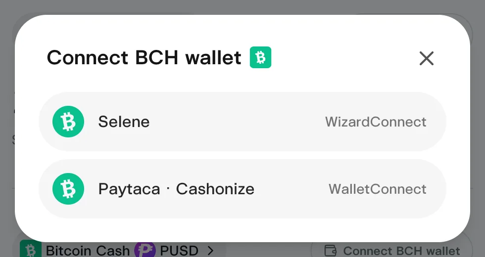

# Cash Bridge

**Stablecoins in and out of Bitcoin Cash, in a few clicks.**
Send USDC from Ethereum, Base or any other chain THORChain supports and receive PUSD on Bitcoin Cash. Or sell PUSD and get USDC back on the other chain. Live on mainnet.

<p align="center">
  <a href="https://www.cashbridge.space"><b>Open the app</b></a> ·
  <a href="docs/media/cashbridge-promo.mp4">Watch the 17-second film</a>
</p>

[](docs/media/cashbridge-promo.mp4)

> **Built in collaboration with THORChain.** Cash Bridge runs on THORChain's official swap API (`api.thorchain.org`) with an API key issued by THORChain, and every transfer is a regular THORChain swap you can look up on THORChain's explorer. See [Verify the THORChain integration](#verify-the-thorchain-integration).

## Highlights

- **Both directions.** USDC to PUSD, and PUSD back to USDC, from one form.
- **Every THORChain chain.** Ethereum, Base, Avalanche, BNB Smart Chain, Bitcoin, Solana, TRON, XRP Ledger, Litecoin, Dogecoin, Cosmos and more. USDC, USDT, ETH, BTC, SOL and the other assets THORChain lists.
- **Bitcoin Cash stablecoins.** PUSD (ParyonUSD) by default, MUSD (Moria USD), and any other CashToken with liquidity on Cauldron.
- **Fast.** Bitcoin Cash steps count as done once the network accepts them, so the token swap starts within seconds of the BCH arriving. Most of a transfer is THORChain's own swap.
- **No fee from Cash Bridge.** You pay only the network and pool fees, and every figure is shown before you sign.
- **One signature with the Cashbridge Router.** Approve once in your source wallet. Cash Bridge receives the BCH, buys PUSD on Cauldron and pays it to any CashTokens address, even one with no wallet connected.
- **The wallets you already use.** Selene over WizardConnect, Paytaca and Cashonize over WalletConnect, and MetaMask, Rabby, Phantom, Ledger, Trezor and more on the other side. They reconnect on every visit.
- **Self-custody by default.** In manual mode only your wallets ever hold your funds.
- **Checked on chain.** Every step's status is read from the chains themselves, not from third-party status pages.

## Try it

1. Open **[www.cashbridge.space](https://www.cashbridge.space)**.
2. **With USDC on Base or Ethereum:** keep *PUSD* as the destination, enter an amount, connect your wallet and your BCH wallet, and press the button. Turn on the **Cashbridge Router** to sign once and paste a receiving address instead.
3. **With BCH or PUSD:** press the arrows to bridge back and receive USDC on Base, paid to the wallet you connect on that side.

On mainnet, 5 USDC on Base became 4.87 PUSD in about 7 minutes, and 4.87 PUSD went back to 4.83 USDC on Base in about 4 minutes. Fees are mostly fixed, so larger amounts lose a smaller share.

## Bridge in four steps

<p align="center"></p>

1. **Pick what you send.** Choose a chain, then a token. Anything THORChain can swap into BCH is on the list.
2. **Pick what you receive.** PUSD is the default. Choose MUSD, plain BCH, or any other CashToken traded on Cauldron.
3. **Enter an amount and connect your wallets.** The estimate and the price impact update as you type. Settings holds the slippage limit, 1% by default.
4. **Confirm.** The confirmation screen lists every transaction, the minimum you will receive and the fees. Approve it in your wallet and follow the progress. In manual mode you then sign the swap into PUSD in your BCH wallet, or keep the BCH.

<table>
<tr>
<td valign="top" width="50%"></td>
<td valign="top" width="50%"></td>
</tr>
</table>

## Manual or Cashbridge Router

| | **Manual** (default) | **Cashbridge Router** |
| --- | --- | --- |
| Signatures | One in your source wallet, one in your BCH wallet | One, in your source wallet |
| Who holds the funds | Only you, always | Cash Bridge holds the BCH from THORChain's payout until your PUSD is sent |
| Works for | Any destination token | Transfers to PUSD and to plain BCH |
| If the price moves | You decide at the second signature | A fixed minimum applies, otherwise the BCH goes to your fallback address, less the miner fee |

The Cashbridge Router switch sits above the form. With it on you can also paste a receiving address instead of connecting a BCH wallet.

> **The Cashbridge Router holds your BCH for a short time.** Use manual mode if you are unsure, and start small.

<p align="center"></p>

## Bridge back from Bitcoin Cash

Press the arrows between the two fields. Sell PUSD, MUSD or BCH and receive USDC or another asset on the other chain, paid straight to your wallet there. Your BCH wallet signs both steps: the Cauldron swap into BCH, then the BCH deposit to THORChain.

<table>
<tr>
<td valign="top" width="50%"></td>
<td valign="top" width="50%"></td>
</tr>
</table>

## How it works

A transfer is a short chain of ordinary mainnet transactions. Each one is signed in a wallet you control.



- **THORChain** swaps the source asset for native BCH through its official API. If a swap cannot complete, for example because the price moved past your slippage limit, THORChain refunds the source asset.
- **Cauldron** is an AMM on Bitcoin Cash whose pools are covenant contracts. Cash Bridge builds the swap transaction itself from the live pools, checks each pool is still unspent and reviews every output before your wallet signs.
- **Status** comes from the chains: EVM nodes for the source and payout, Electrum (Fulcrum) servers for Bitcoin Cash. THORChain's status only fills gaps such as refunds.
- **0-conf.** A Bitcoin Cash transaction accepted into the mempool counts as done, which is what makes the second step fast.

With the **Cashbridge Router** on, THORChain pays the BCH to an address Cash Bridge controls for that one order. The Cashbridge Router verifies the deposit on chain, buys PUSD on Cauldron and pays it to you in the same transaction, or returns the BCH if the fixed minimum cannot be met. More detail in [transaction flows](docs/how-it-works.md).

### Verify the THORChain integration

- Every quote and swap request goes through [`src/app/api/thorchain`](src/app/api/thorchain/%5B...path%5D/route.ts) to THORChain's official API at `api.thorchain.org`, authenticated with the API key THORChain issued. The key stays on the server and never reaches the browser.
- The first step of each transfer is a standard THORChain swap. Paste its source transaction hash into THORChain's tracker or explorer to see the swap, the BCH payout and its memo.
- THORChain's team can confirm the collaboration directly.

## Wallets

| Side | Wallets | How it connects |
| --- | --- | --- |
| Source or destination chain | MetaMask, Rabby, Brave Wallet, OKX, Phantom, Trust Wallet, Exodus, Keplr, Vultisig, TronLink, Ledger, Trezor | Browser extension or hardware wallet |
| Bitcoin Cash | Selene | WizardConnect: scan a QR code or open a link |
| Bitcoin Cash | Paytaca, Cashonize | WalletConnect: QR code, link, or the Paytaca extension |

Wallets reconnect on their own the next time you visit. Cash Bridge never asks for a seed phrase or a private key.

<p align="center"></p>

## Fees and limits

Cash Bridge adds no fee of its own. A transfer still pays:

| Cost | Paid to |
| --- | --- |
| Network fee (gas) on the source chain | The validators or miners of that chain |
| THORChain bridge fee | THORChain: a liquidity fee for the swap and an outbound fee for the payout |
| Cauldron swap fee | The liquidity providers of the pool |
| Bitcoin Cash network fee | Bitcoin Cash miners, a very small amount |

Trading against a pool also moves its price, which shows up as price impact. The confirmation screen breaks all of this down before you sign.

Cash Bridge sets no minimum or maximum of its own. THORChain still has a smallest amount per route, very large amounts run into pool depth, and the Cashbridge Router limits how much BCH it holds for open orders.

## Security and custody

- **Manual mode is non-custodial.** Your wallets sign every transaction. Cash Bridge reviews every output of a Cauldron swap before you sign and checks that the signed result carries only your own signatures.
- **The Cashbridge Router holds the BCH briefly.** From THORChain's payout until your PUSD is sent, or the BCH is returned, the Cashbridge Router holds the BCH for that order. Each order has its own address and a fixed minimum, signed transactions are stored before they are broadcast, and an order that cannot be settled safely is held for review instead of being paid twice.
- **Your browser keeps the record.** Transfer history lives in your browser. Clearing it removes the record, not your funds.
- **Transfers cannot be reversed.** Check addresses, read what your wallet shows, and start small.

## FAQ

<details>
<summary><b>What are PUSD and MUSD?</b></summary>

Dollar-pegged tokens on Bitcoin Cash: ParyonUSD (`2469acc5afa4b10cb5b5c04afb89c3a3ffd61c5da9c01e26d00951cae2a02544`) and Moria USD (`b38a33f750f84c5c169a6f23cb873e6e79605021585d4f3408789689ed87f366`). Tokens on Bitcoin Cash are called CashTokens and are identified by these category ids.
</details>

<details>
<summary><b>An asset is greyed out.</b></summary>

THORChain has paused trading in that asset. Your funds are not affected. Pick another asset or try again later.
</details>

<details>
<summary><b>The BCH arrived, but not the PUSD.</b></summary>

In manual mode the swap into PUSD is a second transaction that you sign in your BCH wallet. Press the swap button on the progress screen, or continue from History. You can also keep the BCH. With the Cashbridge Router this step is done for you.
</details>

<details>
<summary><b>I closed the tab. Is the transfer lost?</b></summary>

No. THORChain carries on by itself and the record is in your browser. Open the site again in the same browser.
</details>

<details>
<summary><b>THORChain refunded my transfer.</b></summary>

THORChain refunds when it cannot complete a swap, for example when the price moved past your slippage limit. The refund goes back to the address that sent it. Raise the slippage limit in Settings and try again.
</details>

## Run it yourself

Use Node.js 22.23.4, as in CI (minimum 22.22.2 on Node 22).

```bash
npm install
npm run dev
```

Open [http://localhost:3000](http://localhost:3000). Copy `.env.example` to `.env.local` and set `THORCHAIN_API_KEY` (server-only, never commit it).

| Command | What it does |
| --- | --- |
| `npx tsc --noEmit -p tsconfig.json` | Typecheck |
| `npm run test:bridge` | Bridge, store, proxy and address tests |
| `npm run test:auto-bridge` | Cashbridge Router API, recovery, custody and signing tests |
| `npm run test:i18n` | Localization checks |
| `npm run build` | Production build (`output: 'standalone'`) |

**Deploying.** A standard Next.js build. On Vercel, import the repository and set the variables from `.env.example`; `THORCHAIN_API_KEY` must stay server-side. The Cashbridge Router runs as a separate service behind an authenticated HTTPS order API; never put its wallet, database or RPC credentials on Vercel.

**Where things are.** Bridge UI in `src/components/swap/`, flow logic in `src/lib/` (`bridge.ts`, `cauldron.ts`, `reverse-bridge.ts`), the Cashbridge Router service in `src/server/auto-bridge/`.

## Built with

[THORChain](https://thorchain.org) for cross-chain swaps, [Cauldron](https://cauldron.quest) for Bitcoin Cash token liquidity, [ParyonUSD](https://paryonusd.com) and [Moria](https://moria.money) stablecoins, [WizardConnect](https://docs.riftenlabs.com/wizardconnect/dapp) and [WalletConnect](https://walletconnect.com) for Bitcoin Cash wallets, and Next.js.

## License

MIT. See [LICENSE](./LICENSE).
